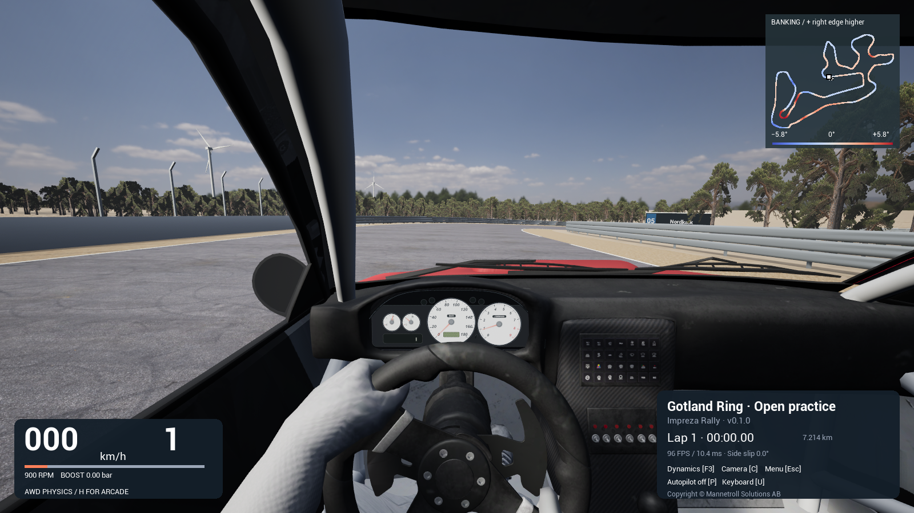
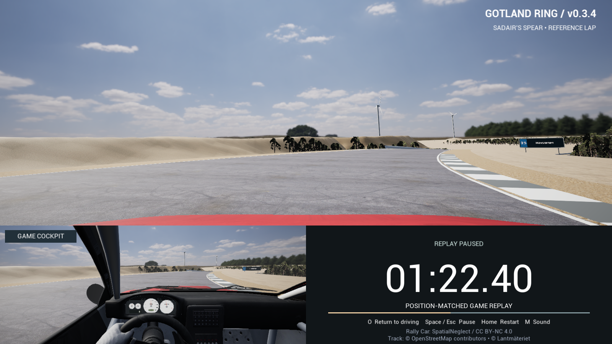
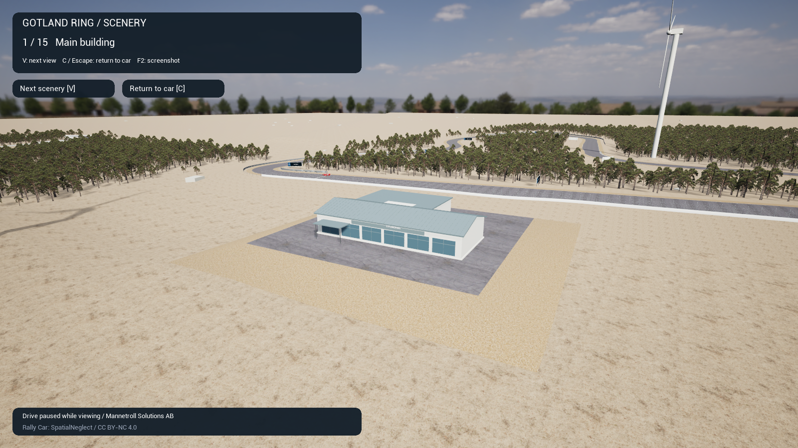

# Gotland Ring / Impreza — Unreal Engine



| SADAIR’S SPEAR reference lap | Gotland Ring scenery |
|---|---|
|  |  |

**Drive a rally Impreza around a Baltic circuit, with a live cockpit, open practice and a reference-lap viewer.**

**Game source:** [unreal.8](https://github.com/mannetroll/GotlandRingUnreal/tree/unreal.8) · **Published downloads:** [Releases](https://github.com/mannetroll/GotlandRingUnreal/releases) · **Unity project:** [GotlandRing](https://github.com/mannetroll/GotlandRing)

An Unreal Engine **5.8** driving prototype using the original GotlandRing road geometry, scenery, car textures and Impreza engine recordings. The approximately **7.214 km** circuit includes banked asphalt, gravel aprons, woodland, limestone quarry banks, barriers, buildings, numbered signs and twelve rotating wind turbines.

The current build includes **AWD physics and arcade handling**, an animated driver with steering and regrips, the Plesse analogue cluster, rebindable controls, four driving cameras, **15 scenery views**, and **SADAIR’S SPEAR • REFERENCE LAP**. The game is implemented in native C++ and renders through Unreal; Unity is only needed when regenerating source assets.

## Get behind the wheel

**Windows x64:** double-click **GotlandRingUnreal-Portable.exe**. Copy that one file when moving the game to another computer. The game, its runtime DLLs and the launcher's .NET runtime are bundled; no Unreal Editor, separate .NET installation or installer is required.

First launch extracts the game to `%LOCALAPPDATA%\Mannetroll\GotlandRingUnreal\<payload hash>`. Subsequent launches reuse that version. The current EXE is approximately **388 MB**; allow space for both the EXE and the approximately **494 MB** extracted game.

**macOS Apple Silicon:** open **GotlandRingUnreal.app**. The complete game is inside the app bundle; no Unreal Editor is required. The current build targets **macOS 14 or newer** on an Apple Silicon Mac. Keep the accompanying asset credits when sharing a packaged build.

The current single-file Windows EXE and macOS app are local build outputs. The published [v0.1.0 release](https://github.com/mannetroll/GotlandRingUnreal/releases/tag/v0.1.0) contains earlier Windows ZIP and installer builds. Use the build instructions below to reproduce the current game.

| Control | Action |
|---|---|
| W / Up arrow | Accelerate |
| S / Down arrow | Brake and cut drive |
| A / D or Left / Right arrows | Steer in keyboard mode |
| X | Reverse; brakes forward travel before reversing |
| Space | Rear handbrake while driving |
| U | Toggle keyboard / mouse steering |
| Mouse | Look around or orbit in keyboard mode; steer in mouse mode |
| Right mouse | Centre the view and mouse steering |
| P | Toggle Auto(P)ilot |
| C | Cycle cockpit / bonnet / chase / drone views |
| V | Cycle 15 scenery views; C or Escape returns to the saved drive |
| O | Open / leave the SADAIR’S SPEAR reference lap |
| H | Switch AWD / arcade handling and restart the lap |
| F3 / F1 | Open driving, view, sound and drone settings |
| R | Recover to the nearest road section |
| Home | Restart at start/finish |
| Escape | Open / close the pause menu |
| F | Toggle fullscreen / windowed while driving or in menus |
| J | Show / hide the driving HUD |
| M | Mute / unmute sound |
| T | Toggle and save tyre squeal; off by default |
| F2 | Save a driving, scenery or reference-lap screenshot |

These are the default bindings. **Escape → Keyboard help & setup** lets you change, clear, restore and save driving keys. On-screen hints follow saved bindings. On compact Mac keyboards, Home is usually **Fn + Left arrow**; function keys may require Fn.

## Inside the prototype

- A textured Impreza rally coupe in Splash red, with a cockpit, roll cage, single driver and rotating/steering road wheels.
- Animated arms and hands using the source driver mesh and seven-bone skin. Elbows bend and hands release and regrip as the steering wheel turns.
- Live Plesse speed and RPM needles, gear, fuel indication and trip distance. The cluster also appears as an overlay in exterior driving views.
- A complete circuit reconstructed from the supplied 3 m surface CSV, including asymmetric widths, banking and crown/hollow profiles.
- Imported limestone ground, quarry piles, pit building, catch fencing, Armco and concrete barriers, edge markings, kerbs and **10,595 mapped pine trees**.
- **42 numbered track signs** with centred Swedish names, white lettering and navy/blue panels.
- **Twelve wind turbines** using the supplied positions and dimensions. Rotors face west and turn clockwise from the front at **10 RPM**.
- A photographic HDR sky with the original white clouds, reused road and car textures, and fixed daylight exposure with bloom and lens flare disabled.
- An independent engine/flywheel model, automatic clutch, five-speed gearbox, reverse, turbo boost, four-wheel drive, suspension and tyre forces.
- Autopilot using the exported racing line and speed plan through ordinary steering, throttle and brake inputs.
- A live reference-lap viewer with bonnet and cockpit views, a lap clock, animated driver and estimated Impreza engine controls.
- Recorded engine-cycle audio with RPM/load blending, plus separate asphalt, kerb and loose-ground rolling sounds.
- A banking-coloured minimap, live car marker, start/finish checker, FPS/frame time and checkpoint-gated lap timing.

## Driving environment

The saved startup level is **`/Game/Migration/Prototype`**. Driving starts in the cockpit with autopilot off. **C** switches to bonnet, chase and drone views; mouse movement changes the view, and right-click recentres it.

Press **V** for the scenery tour: the main building, turbine 2, fencing, Gutemålrakan, the quarry, kerbs, three turbine groups and the circuit overview. Each press advances; the fifteenth view is followed by a return to your car. **C** or **Escape** exits early. Position, momentum, handling mode, autopilot and lap timing are preserved. Turbines continue rotating during the tour.

The minimap uses all **2,405 road sections** and a symmetric **±5.8°** banking legend. Blue indicates negative banking, red positive banking, and positive banking raises the right edge. Ordered quarter-circuit gates prevent reverse crossings and recovery jumps from awarding a lap. **Home** restarts the timer while preserving the session best; changing handling mode with **H** also clears the best time.

This Unreal build has one drivable Impreza. Unity's training pad, second-car selection, paint cycling and Desktop screenshots with embedded metadata are not included.

### Driving dynamics

**F3** pauses driving and opens settings. AWD exposes tyre grip, front torque share, steering angles, steering rate and traction control. Defaults include **50:50 torque distribution**, **42° low-speed / 19° high-speed steering**, and a **90 degrees/s** steering rate.

The arcade comparison uses Unity's bicycle-model controller, with editable cornering grip, lateral grip, steering response, acceleration, braking and off-road grip. **H** switches between AWD and arcade and restarts the lap.

The **View & sound** tab controls cockpit movement and surface sound, defaulting to **50%** and **65%**. Drone settings control height (**5–60 m**, default **30 m**) and follow distance (**5–120 m**, default **40 m**). **Apply & close** saves; **Cancel** discards edits; **Restore defaults** changes the draft until applied. Settings preserve the prior pause state.

AWD engine RPM follows combustion torque, flywheel inertia and clutch load rather than being set directly from road speed. The drivetrain includes automatic gear changes, shift delays and rev matching. Four raycast tyre contacts apply suspension and combined longitudinal/lateral forces to **Chaos**, with traction control, ABS, powered slip and increased lift-off grip.

The contact solver is an Unreal implementation, so matching source parameters does not establish identical Unity handling or calibrated real-car behaviour. Circuit dimensions, scenery heights and vehicle response remain prototype approximations. Damage, opponents, tyre temperature/wear, fuel consumption and coolant simulation are not implemented; fuel and coolant indications use the source defaults.

### Mouse steering

Press **U** to hold steering with horizontal mouse movement. **W/Up**, **S/Down** and **X** remain the pedals and reverse control. Keyboard steering is ignored in mouse mode, and right-click centres steering. Switch back to keyboard mode to use mouse look and orbit.

### Reference lap viewer

Press **O** for **SADAIR’S SPEAR • REFERENCE LAP**, matched to the [onboard reference](https://youtu.be/fSb8Rx1OKHI). It renders the circuit live, with a bonnet view above a **GAME COCKPIT** inset and reference clock.

| Replay control | Action |
|---|---|
| O | Return to the saved drive or its pause menu |
| Space / Escape | Pause / resume playback |
| Home | Restart playback |
| M | Toggle sound |
| F2 | Save the composed view |

The **3:06 sequence** contains **4,464 samples at 24 Hz**, including an approach and a **2:55.88 reference lap**. Playback stops at the end. Driving time does not advance while watching, and returning restores the car's position, momentum, handling mode, autopilot and lap progress.

This is a position-matched rendering with estimated engine controls, rather than a physics lap or measured Subaru telemetry. It uses the same car artwork, animated hands and instrument display as driving. No source video or video decoder is required to play it.

### Auto(P)ilot

**P** hands steering, throttle and braking to the circuit controller; press it again for manual driving. Manual pedal and steering inputs do not cancel autopilot. Camera selection, mouse look, pause and settings remain available.

The controller follows the exported racing line and speed plan, previews braking and corrects AWD sideslip/yaw error. It drives through the same force path as keyboard input. Engaging while facing away from the road or entering a corner too fast can still run wide.

## Build it

**Game:** Unreal Engine **5.8**, native C++ and Chaos. Packaged builds are Windows x64 and macOS ARM64/Metal. The tested Mac engine is **5.8.4**.

**Windows single-file launcher:** .NET **10**, published self-contained for Windows x64. The SDK is needed to build the launcher, not to run it.

Open **`GotlandRingUnreal.uproject`**, build its C++ editor target and open **`/Game/Migration/Prototype`**. Saved road, scenery, sky and vehicle assets are committed under `Content/Migration`; normal game builds do not need Unity or the source recordings.

### macOS (Apple Silicon)

Install Unreal Engine 5.8 and Xcode, then run from the repository root:

```bash
bash Scripts/PackageMac.sh "$PWD/../Releases/unreal.8-macOS"
open ../Releases/unreal.8-macOS/Mac/GotlandRingUnreal.app
```

The script detects Unreal at `~/Epic Games/UE_5.8`. For another installation:

```bash
UE_MAC_ROOT="/path/to/UE_5.8" bash Scripts/PackageMac.sh "$PWD/../Releases/unreal.8-macOS"
```

It builds, cooks, stages and packages the app, applies the mirrored Unity Impreza icon, and copies the asset credits. The local app is ad-hoc signed; public distribution signing/notarization is separate.

### Windows (x64)

Install Unreal Engine 5.8, Visual Studio C++ Build Tools and a Windows SDK. Run from the repository root in PowerShell. Set the engine path for your machine; Fractal uses `C:\UE_5.8`.

```powershell
$UE = 'C:\UE_5.8'
$Project = Join-Path $PWD 'GotlandRingUnreal.uproject'
& "$UE\Engine\Build\BatchFiles\Build.bat" GotlandRingUnrealEditor Win64 Development "-Project=$Project" -WaitMutex
```

To make a portable game folder, stage the Microsoft C++ runtime DLLs alongside the game:

```powershell
$vswhere = "${env:ProgramFiles(x86)}\Microsoft Visual Studio\Installer\vswhere.exe"
$vs = & $vswhere -latest -products '*' -requires Microsoft.VisualStudio.Component.VC.Tools.x86.x64 -property installationPath
$redist = Get-ChildItem "$vs\VC\Redist\MSVC" -Directory |
    Where-Object { $_.Name -match '^\d+\.' } |
    Sort-Object { [version]$_.Name } -Descending | Select-Object -First 1
$deps = Join-Path $PWD 'Saved\PortableDependencies'
$crt = Join-Path $deps 'Win64\x64\Microsoft.VC143.CRT'
New-Item -ItemType Directory -Force $crt | Out-Null
Copy-Item "$($redist.FullName)\x64\Microsoft.VC143.CRT\*.dll" $crt -Force
$output = Join-Path $PWD '..\Releases\unreal.8-portable'
& "$UE\Engine\Build\BatchFiles\RunUAT.bat" BuildCookRun "-project=$Project" `
    -noP4 -platform=Win64 -clientconfig=Shipping -build -cook `
    -map=/Game/Migration/Prototype -stage -pak -iostore -archive `
    "-archivedirectory=$output" "-applocaldirectory=$deps" -nodebuginfo -unattended
Copy-Item LICENSE,DATA_LICENSES.md,VEHICLE_ASSET_CREDITS.md,ENGINE_AUDIO_CREDITS.md "$output\Windows"
```

The result is **`<output>\Windows\GotlandRingUnreal.exe`** with its adjacent game data. Keep that complete folder together.

To wrap it in one portable EXE, install the .NET 10 SDK and run:

```powershell
.\Scripts\PackageSingleFile.ps1 `
    -PackageDirectory "$output\Windows" `
    -OutputDirectory "$PWD\..\Releases\unreal.8-single-file"
```

The result is **`GotlandRingUnreal-Portable.exe`**, plus a checksum file and build metadata. Only the EXE is needed to play. `--extract-only` prepares its cache without starting the game; other arguments are forwarded unchanged.

### Project layout

| Location | Purpose |
|---|---|
| `GotlandRingUnreal.uproject` / `Content/Migration/Prototype.umap` | Project and startup driving level |
| `Content/Migration/` | Saved road, gravel aprons, scenery, sky, vehicle meshes and textures |
| `Source/GotlandRingUnreal/RingCar.cpp` | Driving pawn, input and Chaos force integration |
| `RingDynamics.h` / `RingCarSettings.cpp` / `RingArcade.cpp` in `Source/GotlandRingUnreal/` | AWD drivetrain/tyres, saved settings and arcade handling |
| `RingCarView.cpp` / `RingDriver.cpp` / `RingInstruments.cpp` in the same source folder | Cameras, skinned driver and live cluster |
| `RingReference.cpp` / `RingSceneryViews.cpp` / `RingWind.cpp` in the same source folder | Reference lap, 15-view tour and rotor animation |
| `RingMenu.cpp` / `RingPresentation.cpp` in the same source folder | Pause/settings menus, keyboard setup, HUD, signs and minimap |
| `RingAudio.cpp` / `RingEngineMixer.h` / `RingSurfaceMixer.h` in the same source folder | Recorded engine cycles and surface sound |
| `Scripts/` | Asset export/import, rendering, packaging and validation tools |
| `PortableLauncher/` | Self-contained Windows launcher and application icon |
| `Tests/` / `Validation/` | Source comparisons, standalone checks and recorded results |
| `Renders/` | Captures from the Unreal game |

Asset regeneration tools use a sibling **`GotlandRingUnity`** checkout and an isolated Unity staging project under the ignored `Export/` directory. They reuse the source road samples, runtime scenery construction, car assets, driver weights and replay timeline. This is separate from compiling the committed Unreal project.

## Lines of code

**3,673 code lines across 78 project source files**, counted with [cloc 2.06](https://github.com/AlDanial/cloc/tree/v2.06). These are physical lines containing code; comment-only and blank lines are listed separately.

| Component | Language | Files | Code | Comments | Blank |
|---|---|---:|---:|---:|---:|
| Unreal module, including in-game checks | C++ / headers | 26 | 1,911 | 18 | 12 |
| Asset export/import and data tools | Python | 26 | 971 | 35 | 20 |
| Unity asset export bridge | C# | 5 | 219 | 1 | 4 |
| Windows build, packaging and verification | PowerShell | 9 | 182 | 0 | 0 |
| Native source comparisons | C++ | 5 | 148 | 1 | 2 |
| Portable EXE launcher | C# | 1 | 74 | 0 | 2 |
| Cockpit display shader | HLSL | 1 | 65 | 2 | 0 |
| C# reference checks | C# | 2 | 41 | 1 | 0 |
| macOS packaging and icon tools | Bash | 2 | 37 | 0 | 0 |
| Windows test runner | Batch | 1 | 25 | 0 | 0 |
| **Total** | | **78** | **3,673** | **58** | **40** |

Generated track, replay, driver-skin, presentation, scenery-view and audio tables add **10,090 source/data lines in seven files**, excluded from the project-code total above. The count also excludes Unreal Engine and other dependencies, build outputs, assets, documentation, project configuration, and the C# `.Build.cs` / `.Target.cs` configuration files.

To reproduce the project-code count from the repository root with `cloc` and `rg` installed:

```bash
git ls-files Source Scripts Tests PortableLauncher \
    | rg '\.(cpp|h|inl|cs|py|ps1|cmd|sh|hlsl)$' \
    | rg -v '\.(Build|Target)\.cs$|/(EngineCycles|RingDriverData|RingReferenceData|RingRouteData|RingPresentationData)\.h$|/(RingKerbs|RingSceneryViews)\.inl$' \
    > /tmp/gotland-unreal-code-files.txt
cloc --list-file=/tmp/gotland-unreal-code-files.txt --skip-uniqueness
```

## Verification

The current packaged game passes **five rendered checks on macOS and five on Windows/Fractal**. Windows checks run in an interactive Windows 11 session; Windows 10 runtime testing has not been performed.

| Check | macOS | Fractal / Windows |
|---|---|---|
| Reference lap, animated driver, 15 views, arcade handling and menu restoration | [Pass](Validation/migration_reference_macos.json) | [Pass](Validation/migration_reference_fractal.json) |
| GPU-rendered instrument needles, gear/trip state and steering-wheel direction | [Pass](Validation/instruments_reference_macos.json) | [Pass](Validation/instruments_reference_fractal.json) |
| Settings persistence, pause restoration and drone/cockpit camera settings | [Pass](Validation/settings_reference_macos.json) | [Pass](Validation/settings_reference_fractal.json) |
| Acceleration, braking, steering, road contact and reset | [Pass](Validation/driving_reference_macos.json) | [Pass](Validation/driving_reference_fractal.json) |
| Twelve rotors: speed, direction, fixed hubs and pause/resume | [Pass](Validation/wind_reference_macos.json) | [Pass](Validation/wind_reference_fractal.json) |

The [source/asset comparison](Validation/reference_source_fractal.json) confirms that **188 game source and asset files** match across the two machines. [Audio comparisons](Validation/reference_audio_parity.json) match the current Unity engine and surface mixers at **44.1, 48 and 96 kHz**.

The [single-file EXE check](Validation/single_file_fractal.json) runs from a folder containing only the EXE. It verifies concurrent first-launch extraction, all **42 extracted files** against the original package, cache reuse, argument forwarding with spaces, and the migration, instrument and driving checks through the launcher.

For a rendered test, launch a packaged game with one of these switches:

```text
-RingMigrationTest
-RingInstrumentsTest
-RingSettingsTest
-RingDrivingTest
-RingWindTest
-RingSignsTest
-RingPresentationTest
-RingPilotTest
-RingDynamicsTest
```

For example, on macOS:

```bash
open -n -W ../Releases/unreal.8-macOS/Mac/GotlandRingUnreal.app --args \
    -RingMigrationTest -windowed -ResX=1600 -ResY=900
```

The packaged checks above write JSON results and captures under the game's Saved directory. Inspect the report's `passed` field. Windows editor runners are in `Scripts/Validate*.ps1`. `Scripts/TestPortable.cmd` compares C++ engine/audio behaviour with the sibling Unity source and checks drivetrain, tyre and surface-audio behaviour; it requires Visual Studio C++ Build Tools. `Scripts/ValidateSingleFile.ps1` runs the single-EXE checks in an interactive Windows session with a fresh payload cache.

### Settings and captures

Settings are stored as `DrivingSettings.json` and `KeyboardBindings.json`. F2 screenshots and test reports use the same Saved directory:

| Build | Saved directory |
|---|---|
| Unreal Editor | `<project>/Saved` |
| Packaged Windows | `%LOCALAPPDATA%\GotlandRingUnreal\Saved` |
| Current packaged macOS app | `~/Library/Containers/com.YourCompany.GotlandRingUnreal/Data/Library/Application Support/Epic/GotlandRingUnreal/Saved` |

`-UserDir=<path>` redirects the game's user directory for isolated Windows checks. The portable launcher's extraction cache is separate from these saved preferences.

## Visuals

The environment reuses the source photographic HDR, asphalt, gravel, woodland and vehicle artwork. Road roughness is **0.78** and apron roughness **0.95**. Daylight uses fixed exposure, softer sun/sky fill and no bloom, lens flare or motion blur.

The cockpit wheel uses the source **12:1 visual steering ratio**, following the applied front-wheel angle in manual driving, autopilot and replay. Only the driver's head is hidden in cockpit view. The hands, arms and body remain visible, with procedural steering poses and regrips.

Signs retain their source anchors and fitted text areas. Unlit, exposure-compensated navy faces, blue number panels and white labels keep the text readable in daylight. Turbine hubs remain fixed while their original rotor geometry turns; pause/settings menus freeze them, and accumulated rotation preserves small updates at high frame rates.

Surrounding ground, quarry shapes, building dimensions, tree placement and barrier runs are authored visual approximations. The scene is not surveyed terrain or a calibrated simulator.

## Licensing

Original project code and the derived owner-recorded Impreza engine cycles are covered by the [MIT License](LICENSE), except where another notice applies. See [engine audio credits](ENGINE_AUDIO_CREDITS.md).

The car, cockpit and driver assets have separate **CC BY-NC 4.0** licensing. Preserve the author credits and noncommercial restriction described in [vehicle and visual asset credits](VEHICLE_ASSET_CREDITS.md). HDR/scanned material sources and other visual attributions are documented there as well. Unreal Engine and third-party runtime components retain their own licensing terms.

Track and derived geospatial data have separate attribution and licensing requirements, including OpenStreetMap and Lantmäteriet sources; see [DATA_LICENSES.md](DATA_LICENSES.md).

This is an unofficial fan-made prototype, unaffiliated with GotlandRing or Subaru. Their names and marks remain the property of their respective owners.

## CSV track reconstruction

The road follows the source **3 m surface CSV**, with **2,405 unique cross-sections** and a repeated closing section. Horizontal circuit length is **7,214.397 m**. Start/finish and the spawn use point **284** on Gutemålrakan.

The migration retains the supplied centerline, asymmetric asphalt widths, cross-slope and quadratic crown/hollow profile, with **16 subdivisions across the asphalt**. Banking is encoded in the surface heights and is not added as a second rotation. Three-metre gravel aprons share the road-edge vertices.

Unity's metre coordinates map to Unreal centimetres as **`(X, Y, Z) = (z, x, y) × 100`**. Row zero remains the coordinate origin. The larger meadow, shoulders and quarry are reused source meshes rather than newly acquired terrain data.

AWD wheel rays contact the Unreal collision geometry; arcade driving follows the surface. [Import bounds](Validation/import_validation.json) and [scenery bounds/counts](Validation/scenery_validation.json) are recorded alongside the current rendered driving checks. These source estimates do not establish surveyed elevations, banking or real-car performance.
